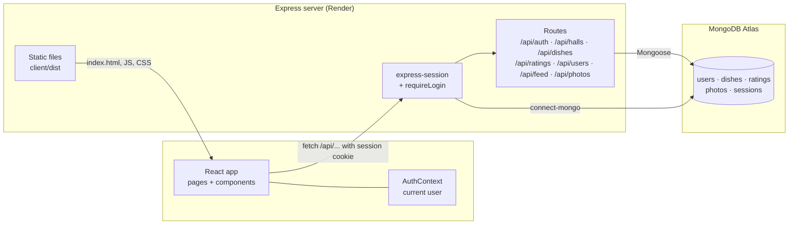
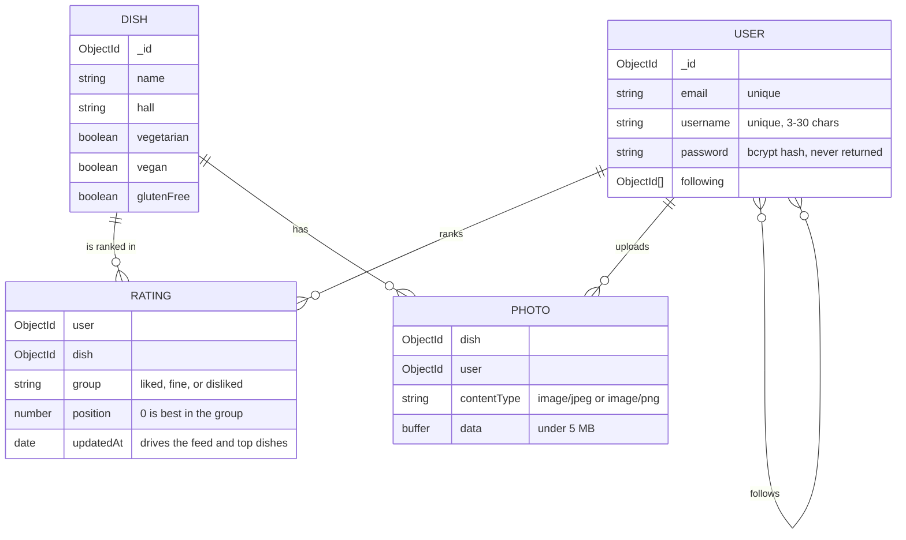
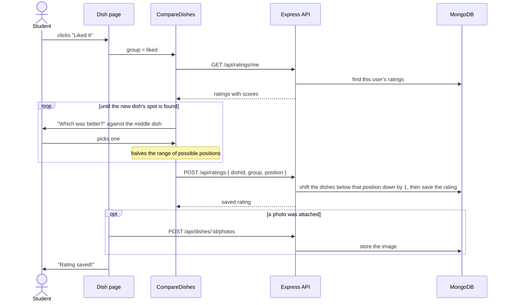

# Bruin Bites

Rank the food at the UCLA dining halls. CS 35L, Fall 2026.

**Live site:** https://bruin-bites.onrender.com

**Team:** Abhinav Garg, Dheeraj Koppu, Sampath Kalagarla, Ved Vyas, Isaac Pan

Built with React (Vite), Express, and MongoDB.

## Features

- **Browse** the four dining halls and their menus, with search and vegetarian, vegan, and gluten-free filters on each hall page.
- **Search** every dish across all halls from the search box in the navbar.
- **Rate and rank** a dish as "Liked it", "It was fine", or "Didn't like it". The app then asks "Which was better?" against dishes you already ranked in that group, binary searching for the new dish's spot. Each ranking turns into a score out of 10.
- **Photos:** attach a JPG or PNG when you rate a dish. Everyone sees it on the dish page.
- **Top this week:** each hall page lists its 10 best dishes from the last 7 days, averaged across everyone's rankings (a dish needs at least 3 rankings to show up).
- **Friends:** search for users, follow them, see their ranked lists, and read a feed of their newest rankings.
- **Accounts:** sign up, log in, and log out. Rating, uploading photos, following, and the feed all require logging in.

## Running it locally

You need [Node.js](https://nodejs.org) 20 or newer and a MongoDB database. Any of these works:

- **MongoDB on your computer:** on a Mac, `brew tap mongodb/brew && brew install mongodb-community && brew services start mongodb-community`. The connection string is `mongodb://localhost:27017/bruin-bites`.
- **Docker:** `docker run -d -p 27017:27017 --name bruin-bites-db mongo`. The connection string is the same as above.
- **MongoDB Atlas:** create a free cluster at [mongodb.com/atlas](https://www.mongodb.com/atlas), add your IP under Network Access, and copy the `mongodb+srv://...` connection string from "Connect → Drivers".

```bash
git clone https://github.com/dheerajkoppu/bruin-bites.git
cd bruin-bites
```

### 1. Server

```bash
cd server
npm install
cp .env.example .env
```

Open `server/.env`, set `MONGODB_URI` to your connection string, and set `SESSION_SECRET` to any long random string. Never commit `.env`.

```bash
npm run seed   # adds the 80 starter dishes to the database
npm run dev    # starts the API on http://localhost:4000
```

### 2. Client

In a second terminal:

```bash
cd client
npm install
npm run dev    # opens the app on http://localhost:5173
```

Open http://localhost:5173. The Vite dev server sends every request starting with `/api` to the Express server, so React code just calls `fetch("/api/...")`.

## Testing

| What | Command | Needs a database? |
|---|---|---|
| Client component and API tests (Vitest) | `cd client && npm test` | No, they fake the server |
| Lint and production build | `cd client && npm run lint && npm run build` | No |
| End-to-end tests (Playwright) | `cd e2e && npm install && npx playwright install chromium && npm test` | No, they start their own in-memory MongoDB |

The end-to-end tests build the client, start the real Express server against a throwaway in-memory MongoDB, seed it, and drive Chromium through signing up, rating and ranking dishes, searching, and following a friend. CI runs all of these on every pull request.

## Architecture

### System overview

In production, one Express server on Render serves both the built React app and the API, so they share a domain and the login cookie just works. Locally, the Vite dev server serves the React app and proxies `/api` to Express.



### Data model

A rating stores only its group and its position within that group. Scores are computed when they're read, by spreading the group's positions evenly across its range (liked 7–10, fine 4–6.9, disliked 0–3.9), so moving one dish never requires rewriting every score.



### Rating and ranking a dish



## API

Requests and responses are JSON unless noted. Errors look like `{ "error": "message" }`. Login state is an HttpOnly session cookie, so send requests with `credentials: "include"`. 🔒 means the route returns 401 when you aren't logged in.

| Request | Returns |
|---|---|
| `POST /api/auth/signup` `{ email, username, password }` | 201 `{ user }` and sets the cookie. 400 for an invalid field, 409 if the email or username is taken |
| `POST /api/auth/login` `{ email, password }` | 200 `{ user }` and sets the cookie. 401 for a wrong email or password |
| `POST /api/auth/logout` | 204 and clears the cookie |
| `GET /api/auth/me` | 200 `{ user }`, or 401 |
| `GET /api/halls` | the hall names |
| `GET /api/halls/:hallName/dishes` | the hall's dishes |
| `GET /api/halls/:hallName/top` | up to 10 dishes with `averageScore` and `rankingCount` from the last 7 days |
| `GET /api/dishes?search=text` | dishes whose name contains the text |
| `GET /api/dishes/:id` | the dish plus `photos`, newest first. 404 if missing |
| `GET /api/ratings/me` 🔒 | your ratings, each with its populated `dish` and `score` |
| `POST /api/ratings` 🔒 `{ dishId, group, position }` | 201 for a new rating, 200 for a re-rating |
| `POST /api/dishes/:id/photos` 🔒 | multipart with one JPG or PNG under 5 MB in the `photo` field. 201 `{ photo }` |
| `GET /api/photos/:id` | the image bytes |
| `GET /api/users?search=text` 🔒 | up to 10 other users whose username contains the text |
| `POST /api/users/:username/follow` 🔒 | follows them |
| `DELETE /api/users/:username/follow` 🔒 | unfollows them |
| `GET /api/users/me/following` 🔒 | `{ following: [{ _id, username }] }` |
| `GET /api/users/:username/ratings` 🔒 | their ranked ratings. 403 unless it's you or someone you follow |
| `GET /api/feed` 🔒 | the newest 50 rankings from people you follow |

## Folders

```
client/
  src/
    pages/        one file per page: Home, Hall, Dish, Search, Login, Signup, Profile, FriendProfile, Feed
    components/   NavBar, CompareDishes, TopDishes, AddDish, ProfileRatings, FindFriends, FollowingList
    context/      AuthContext, which tracks the logged-in user
    api/          fetch helpers for auth and ratings
    App.jsx       routes
    *.test.jsx    Vitest component tests
server/
  index.js        Express app, plus the hall, dish, and rating routes
  routes/         auth, users (follow), feed, and photos routers
  models/         Mongoose models: User, Dish, Rating, Photo
  middleware/     requireLogin and the error handler
  session.js      session cookie setup
  seed.js         loads dishes.json into the database
e2e/
  tests/          Playwright end-to-end tests
  start-server.js runs the real server against an in-memory MongoDB
render.yaml       Render deploy settings
```

## Deploying

The live site runs on [Render](https://render.com) as one web service, with its settings in `render.yaml`. Every merge into `main` deploys on its own once CI passes.

The live site uses its own database, `bruin-bites-prod`, so local testing never touches it. The free plan sleeps after 15 minutes with no visitors, so the first page load after that can take up to a minute.

## How we work

1. Pick an issue assigned to you on GitHub.
2. Make a branch for it: `git checkout -b your-name/short-description`
3. Commit as you go, then push and open a pull request into `main`.
4. Put `Closes #<issue number>` in the PR description.
5. Wait for CI to pass. It runs lint, the client tests, the build, a server syntax check, and the end-to-end tests. If it fails, click "Details" on the check to see why.
6. Get one teammate to review before merging. Don't push straight to `main`.

## Photo credits

The Bruin Plate photo is [Carnesale Commons](https://commons.wikimedia.org/wiki/File:UCLA_Carnesale_Commons.jpg) by Yhz1221 on Wikimedia Commons (CC BY-SA 4.0).
